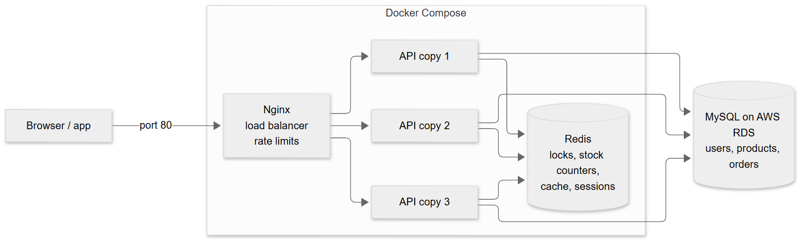
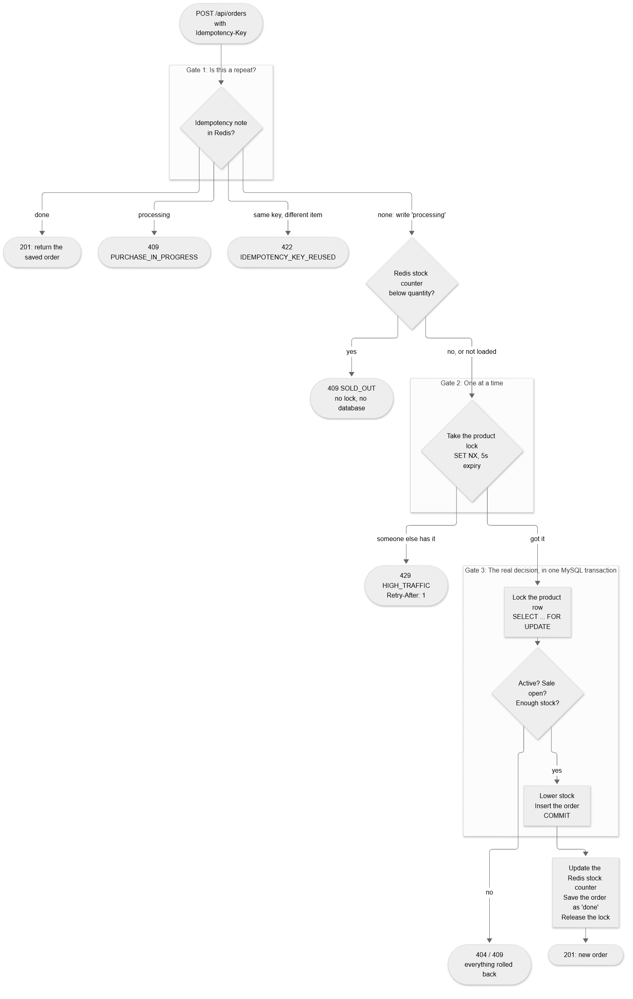
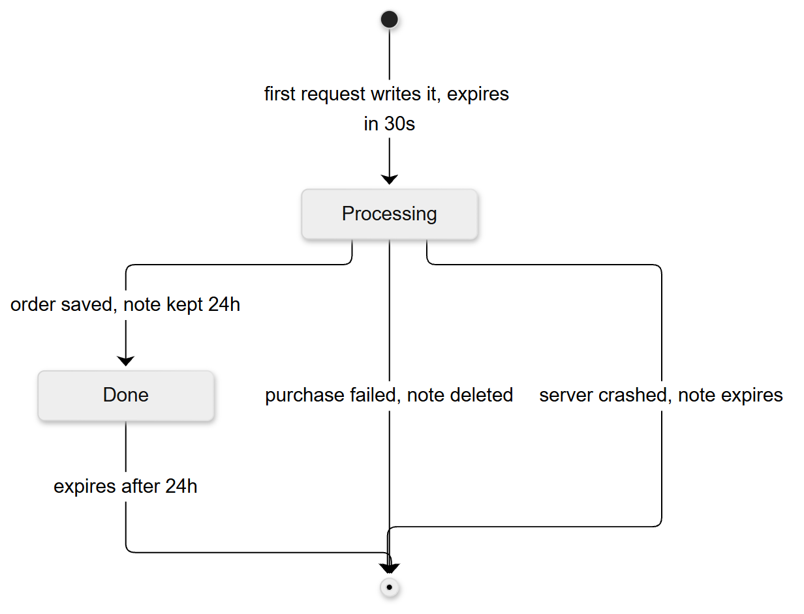
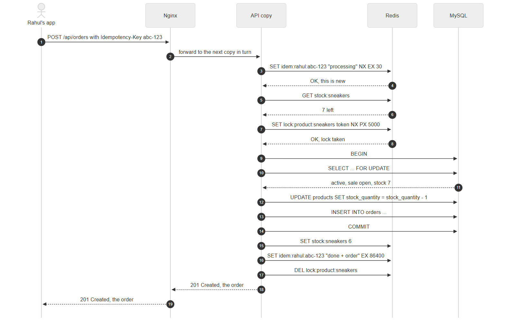
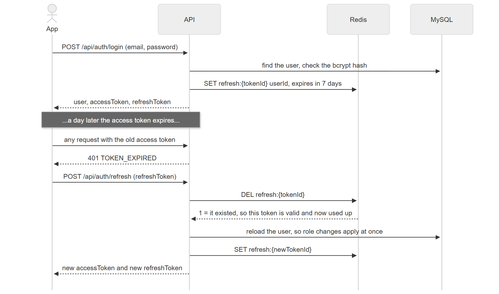
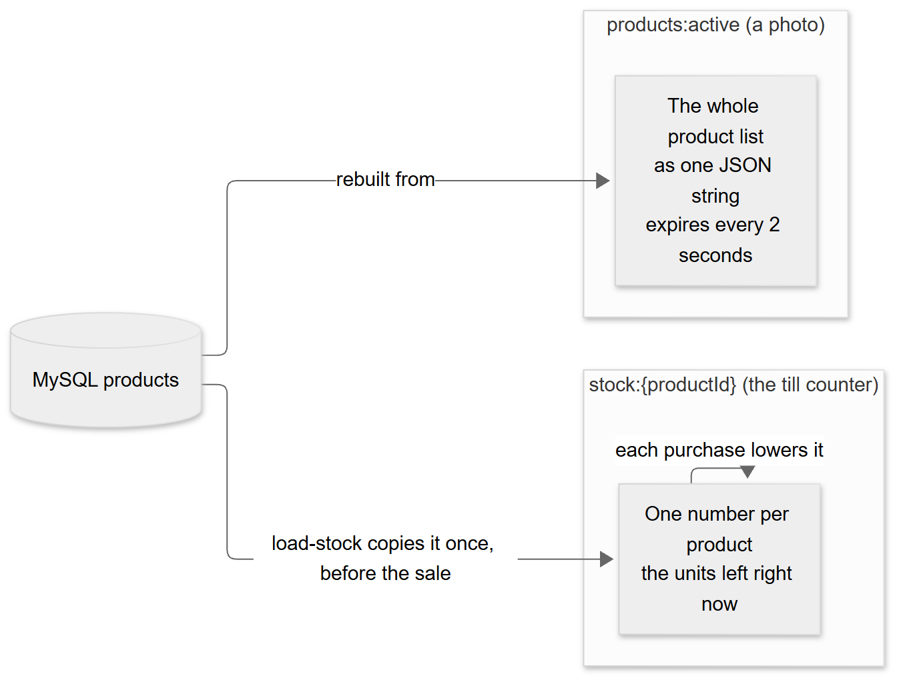
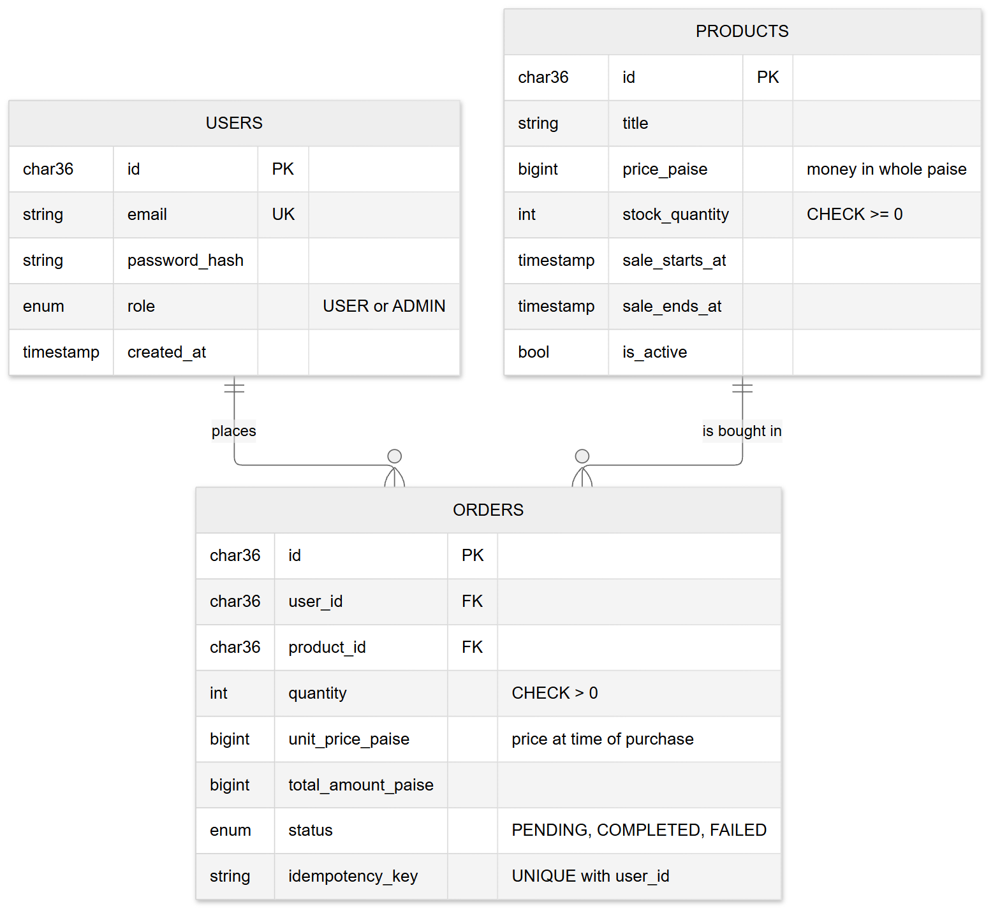

# Flash Sale Backend

A backend for flash sales: a small amount of stock, a fixed start time, and thousands of people pressing **Buy** at the same moment.

It guarantees three things under heavy load:

- **No overselling.** 200 units means exactly 200 orders, never 201.
- **No double orders.** A double-click or a network retry never charges someone twice.
- **The database stays calm.** The crowd is turned away cheaply in Redis before it reaches MySQL.

Built with Node.js, Express 5, MySQL, Redis, Docker Compose and Nginx.

---

## Contents

1. [Architecture](#architecture)
2. [The order flow](#the-order-flow)
3. [Authentication](#authentication)
4. [Products and stock](#products-and-stock)
5. [Data model](#data-model)
6. [API reference](#api-reference)
7. [Running it](#running-it)
8. [Load test results](#load-test-results)
9. [Design decisions](#design-decisions)
10. [Project structure](#project-structure)
11. [Known limitations](#known-limitations)

---

## Architecture



<sub>Diagram source: [`docs/diagrams/01-architecture.mmd`](docs/diagrams/01-architecture.mmd)</sub>

| Part | Job |
|---|---|
| **Nginx** | The single entry point. Spreads requests across the 3 API copies in turn, retries safe requests on another copy if one is down, limits login and register to 10 a minute per IP, and rejects request bodies over 100 KB. |
| **API copies** | Three identical Node.js containers. They hold no state of their own, so any copy can serve any request. |
| **Redis** | Fast shared memory for all copies: purchase locks, live stock counters, idempotency notes, the product list cache and refresh tokens. Saved to disk, so it survives restarts. |
| **MySQL** | The permanent record and the final judge of stock. A row lock and a `stock >= 0` rule make overselling impossible even if Redis misbehaves. |

> **The one-line summary:** Redis keeps it fast. MySQL keeps it correct.

---

## The order flow

A story makes this easier. **10 pairs of sneakers. 2,000 people press Buy at 8:00 PM.**

Every purchase request passes through three gates. Each gate solves a different problem.



<sub>Diagram source: [`docs/diagrams/02-order-flow.mmd`](docs/diagrams/02-order-flow.mmd)</sub>

Whenever a purchase fails, its idempotency note is deleted so a retry can run again, and the lock is always released.

### Gate 1: Idempotency, "is this a repeat?"

**Problem:** the same person accidentally buying twice.

When Rahul opens checkout, his app creates a random key for that purchase attempt, like a receipt number. Every try of that purchase sends the same key in an `Idempotency-Key` header.

The server keeps a note in Redis under `idem:{userId}:{key}`. The user ID is part of the name, so one person can never see another person's order.



<sub>Diagram source: [`docs/diagrams/03-idempotency-note.mmd`](docs/diagrams/03-idempotency-note.mmd)</sub>

| What happens | Note found | Answer |
|---|---|---|
| First tap | None, so it is created | Purchase runs |
| Double-click while the first is running | Processing | 409 already in progress |
| App retries after the first finished | Done | The same order again, nothing bought twice |
| Same key, different product or quantity | Different request inside | 422 key reused |
| A genuine second purchase | None, the app made a new key | Runs as a new purchase |

**Safety net:** the `orders` table has a unique rule on `(user_id, idempotency_key)`. If Redis ever loses a "done" note, the retry hits that rule, and the server returns the existing order instead of creating a second one.

### The sold-out shortcut

Before taking any lock, the server reads the live stock counter `stock:{productId}` in Redis. Once it reaches 0, everyone gets **409 SOLD_OUT** in about 4 ms, without touching MySQL. In the load test, 18,000 buyers were turned away this way.

### Gate 2: The Redis lock, "only one at a time"

**Problem:** 2,000 requests hitting the database at once would jam the 10-connection pool.

Think of a single key to a room. A request must take `lock:product:{productId}` before touching the stock.

- `SET ... NX` creates the lock only if nobody holds it. Redis does the check and the create as one step, so two requests can never both get it.
- Whoever gets it goes in. Everyone else gets **429** at once with `Retry-After: 1`, instead of waiting inside the database.
- The lock expires after 5 seconds, so a crashed server can never block a product forever.

### Gate 3: The MySQL transaction, "the real decision"

**Problem:** overselling, guaranteed.

Inside one all-or-nothing transaction:

1. `SELECT ... FOR UPDATE` locks the product row. No other transaction can change it until this one ends.
2. Check the product is active, the sale has started and not ended (using the database clock), and enough stock is left.
3. Lower `stock_quantity`.
4. Insert the order, storing the unit price at the time of purchase.
5. `COMMIT`. Both changes are saved together. If anything fails, both are undone.

### Why two locks?

| Lock | Purpose |
|---|---|
| **Redis lock** | **Speed.** Turns the crowd away cheaply, before it uses database connections. |
| **MySQL row lock** | **Correctness.** Even if a Redis lock expired early, only one transaction can change the stock at a time. The `CHECK (stock_quantity >= 0)` rule rejects negative stock no matter what. |

### One purchase, step by step



<sub>Diagram source: [`docs/diagrams/04-one-purchase.mmd`](docs/diagrams/04-one-purchase.mmd)</sub>

### How 8:00 PM plays out

| Who | What happens |
|---|---|
| Request 1 | Takes the lock, buys, stock 9, **201** |
| Requests arriving while request 1 holds the lock | **429**, their app waits about a second and retries |
| Rahul's double-click | **409** in progress, no second order |
| Rahul's network retry later | The same order returned, stock unchanged |
| Requests 2 to 10 | Each takes the lock in turn and buys, stock reaches 0 |
| Everyone after that | **409** sold out instantly from Redis |

**Final result:** exactly 10 orders, stock 0, nobody charged twice, and MySQL never overwhelmed.

---

## Authentication

Two tokens, each signed with its own secret:

| Token | Lasts | Holds | Used for |
|---|---|---|---|
| **Access token** | 1 day | user ID, email, role | Every API call, in `Authorization: Bearer <token>` |
| **Refresh token** | 7 days | user ID and a unique token ID | Getting a new pair of tokens |



<sub>Diagram source: [`docs/diagrams/05-auth-refresh.mmd`](docs/diagrams/05-auth-refresh.mmd)</sub>

- **Refresh tokens work once.** Using one deletes it, so a stolen token that was already used is worthless. If two requests send the same token at once, only one succeeds.
- **Logout** deletes the refresh token's Redis entry, so it stops working immediately.
- **Login doesn't reveal which emails exist.** A wrong password and an unknown email take the same time and give the same answer.
- **Roles:** every new account is `USER`. The `requireAdmin` middleware protects admin routes.

---

## Products and stock

Redis holds two very different kinds of product data.



<sub>Diagram source: [`docs/diagrams/06-cache-vs-stock.mmd`](docs/diagrams/06-cache-vs-stock.mmd)</sub>

| | `products:active` | `stock:{productId}` |
|---|---|---|
| Holds | The whole list as one string | One number per product |
| Purpose | Fast page views | The sold-out shortcut and live stock |
| Can be a little old | Yes, up to 2 seconds | No |
| Safe to delete | Yes, it rebuilds itself | No, it tracks what has sold |

**Why stock isn't kept inside the cached list:** changing one number inside a JSON string means read, edit, write back. Two buyers doing that at once would both write "69" and one sale would be lost. A separate counter is changed in a single Redis step.

**Before a sale,** an admin calls `POST /api/products/:id/load-stock`. It uses `SET NX`, so calling it again during a sale can never reset a live counter and resell units.

---

## Data model



<sub>Diagram source: [`docs/diagrams/07-data-model.mmd`](docs/diagrams/07-data-model.mmd)</sub>

- **Money is stored as whole paise** (₹4,999.00 is `499900`), so there are never rounding errors.
- **Each order stores its own unit price,** so changing a product's price never changes old orders.
- **All dates are stored and compared in UTC.**

---

## API reference

All error responses look like this:

```json
{ "error": { "code": "SOLD_OUT", "message": "Not enough stock left" } }
```

Validation errors add a `details` list with one entry per bad field.

### Auth: `/api/auth`

| Method | Path | Body | Success |
|---|---|---|---|
| POST | `/register` | `email`, `password` (8+ characters) | 201, user and both tokens |
| POST | `/login` | `email`, `password` | 200, user and both tokens |
| POST | `/refresh` | `refreshToken` | 200, a new pair of tokens |
| POST | `/logout` | `refreshToken` | 204 |

### Products: `/api/products`

| Method | Path | Who | What |
|---|---|---|---|
| GET | `/` | Anyone | Active products, cached for 2 seconds |
| GET | `/:id` | Anyone | One product |
| GET | `/:id/stock` | Anyone | Live stock from Redis, or MySQL if not loaded |
| GET | `/all` | Admin | Every product, including inactive |
| POST | `/` | Admin | Create: `title`, `pricePaise`, `stockQuantity`, optional `saleStartsAt`, `saleEndsAt` |
| PATCH | `/:id` | Admin | Change any of the above, plus `isActive` |
| DELETE | `/:id` | Admin | Deactivate (hides it, keeps order history) |
| POST | `/:id/load-stock` | Admin | Copy stock into Redis before a sale |

Dates must include a time zone, for example `2026-12-01T20:00:00+05:30`.

### Orders: `/api/orders`

| Method | Path | Who | What |
|---|---|---|---|
| POST | `/` | Logged in | Buy. Header `Idempotency-Key`, body `productId`, optional `quantity` (default 1) |
| GET | `/mine` | Logged in | Your orders, newest first |
| GET | `/:id` | Logged in | One of your orders |
| GET | `/all` | Admin | Every order |
| GET | `/product/:productId` | Admin | Orders for one product |

Lists take `?limit=20&offset=0`: `limit` is how many to return (max 100), `offset` is how many to skip.

### Purchase answers

| Status | Code | Meaning | Should the app retry? |
|---|---|---|---|
| 201 | | Bought, or the saved order for a repeated key | No |
| 400 | `VALIDATION_ERROR`, `IDEMPOTENCY_KEY_REQUIRED` | Bad input | No, fix the request |
| 404 | `PRODUCT_NOT_FOUND` | No such product | No |
| 409 | `SOLD_OUT`, `SALE_NOT_STARTED`, `SALE_ENDED`, `PRODUCT_INACTIVE` | Can't buy right now | No |
| 409 | `PURCHASE_IN_PROGRESS` | The same key is still being processed | Yes, shortly, with the same key |
| 422 | `IDEMPOTENCY_KEY_REUSED` | Key already used for a different purchase | No, use a new key |
| 429 | `HIGH_TRAFFIC` | Someone else holds the lock | Yes, after `Retry-After` plus a small random delay, with the **same** key |

---

## Running it

You need Docker Desktop and a MySQL database with the `users`, `products` and `orders` tables.

**1. Create a `.env` file** in this folder. It is git-ignored, never commit it.

| Variable | Example | Notes |
|---|---|---|
| `DB_HOST`, `DB_PORT`, `DB_USER`, `DB_PASSWORD`, `DB_NAME` | `localhost`, `3306`, ... | Your MySQL database |
| `SERVER_PORT` | `3000` | |
| `REDIS_HOST`, `REDIS_PORT` | `127.0.0.1`, `6379` | Compose overrides these to use its own Redis |
| `JWT_ACCESS_SECRET`, `JWT_REFRESH_SECRET` | | Two different long random values |
| `JWT_ACCESS_EXPIRES_IN`, `JWT_REFRESH_EXPIRES_IN` | `1d`, `7d` | Optional, these are the defaults |

Generate each secret with:

```bash
node -e "console.log(require('crypto').randomBytes(48).toString('hex'))"
```

**2. Start everything:**

```bash
docker compose up -d --build
```

This starts Nginx on port 80, three API copies and Redis. Check it:

```bash
curl http://localhost/health
# {"status":"ok","instance":"<container>"}  - repeat it to see different copies answer
```

**Useful commands:**

```bash
docker compose logs -f api      # follow the API logs
docker compose logs -f nginx    # see which copy answered each request
docker compose ps               # status and health
docker compose down             # stop (Redis data is kept)
```

**Without Docker:** run Redis yourself, then `npm install` and `node server.js`.

---

## Load test results

Run with the Postman CLI against the full Docker stack through Nginx.

**Workload:** 100 logged-in buyers in a loop of: view products, check live stock, try to buy 1 unit of a product with 200 in stock. Ramped from 1 to 100 buyers over 2.5 minutes, then held for 2.5 minutes.

| Metric | Result |
|---|---|
| Requests | 70,336 with **0 errors** |
| Throughput | 234 requests a second on average, peaking near 300 |
| Latency, 95th percentile | **113 ms** |
| Latency, 99th percentile | 319 ms |
| Requests per API copy | 23,464 each, perfectly even |
| CPU per API copy at 100 buyers | about 8% |

**Correctness after the run:**

| Check | Result |
|---|---|
| Orders created | **exactly 200** for 200 units |
| Duplicate orders | **0** |
| Stock left in MySQL and in Redis | **0** and **0** |

**Time per purchase answer, measured at Nginx:**

| Answer | Count | Median |
|---|---|---|
| Bought (201) | 200 | 321 ms |
| Sold out (409) | 18,108 | 4 ms |
| Busy, retry (429) | 5,104 | 4 ms |

**What the numbers say:**

- **The protection works.** Thousands of competing buyers, exactly the right number of orders.
- **The sold-out shortcut is the hero.** After stock ran out, 18,000 requests were answered in 4 ms without touching the database.
- **Selling is limited by the lock, about 2 to 3 sales a second per product.** Each purchase holds the lock for about 390 ms because the test machine was far from the database. Hosting the API in the same region as the database should cut that to a few milliseconds.
- **The test did not find the backend's limit.** Throughput levelled off while the API used only 8% CPU, so the load generator on the test machine was the bottleneck.

---

## Design decisions

| Decision | Why |
|---|---|
| Redis lock in front of a MySQL row lock | Redis turns the crowd away cheaply. MySQL guarantees correctness even if Redis fails. |
| Idempotency key per purchase attempt, user ID in the Redis key | Double-clicks and retries can't create two orders, and one user can never see another's order. |
| Only successful orders are saved as idempotency results | A retry after "busy" or "sold out" runs again instead of being stuck with an old answer. |
| Unique `(user_id, idempotency_key)` in MySQL | A backup if Redis forgets a result. |
| Sold-out check before the lock | Once stock is gone, nobody queues for the lock just to hear "sold out". |
| Live stock counter separate from the list cache | A counter can be changed safely in one step. A cached JSON string cannot. |
| `load-stock` uses `SET NX` | Reloading during a sale can't reset the counter and resell units. |
| Single-use refresh tokens in Redis | Real logout, and a stolen token stops working once used. |
| Separate secrets for access and refresh tokens | One kind of token can never be used as the other. |
| Money in whole paise, dates in UTC | No rounding errors, no time zone shifts. |
| Nginx lists each API container separately | If one copy is down, Nginx retries on another instead of failing. |
| Nginx retries only safe requests | A purchase (POST) is never sent twice by the load balancer. |

---

## Project structure

```
backend/
├── server.js                 starts the server, checks MySQL and Redis, graceful shutdown
├── index.js                  Express app: security headers, JSON, routes, error handler
├── Dockerfile                API image
├── docker-compose.yml        Nginx + 3 API copies + Redis
├── nginx/nginx.conf          load balancing, rate limits, retries
└── src/
    ├── config/               env, MySQL pool (UTC), Redis client
    ├── middlewares/          requireUser / requireAdmin, error handler
    ├── validators/           Zod request schemas
    ├── routes/               URL -> controller
    ├── controllers/          read the request, call a service, send the response
    └── services/             the business logic: auth, products, orders
```

Each request travels: **route** → **middleware** (auth) → **controller** (validate input) → **service** (logic, MySQL, Redis) → response. Errors from any layer reach one error handler that sends the JSON error format.

---

## Known limitations

- **No payment step.** Orders are saved as `COMPLETED` straight away.
- **No per-buyer limit.** One person can buy all the stock with separate purchases.
- **No way to create an admin** except changing the role in the database.
- **Sales of one product run one at a time** because of the lock. A Redis counter used as the gate would let them run in parallel.
- **The product list cache can stampede.** When it expires, simultaneous misses each query MySQL.
- **Requests wait if Redis goes down** instead of failing fast.
- **No automated tests in the repository yet.**
- **No frontend yet.**
